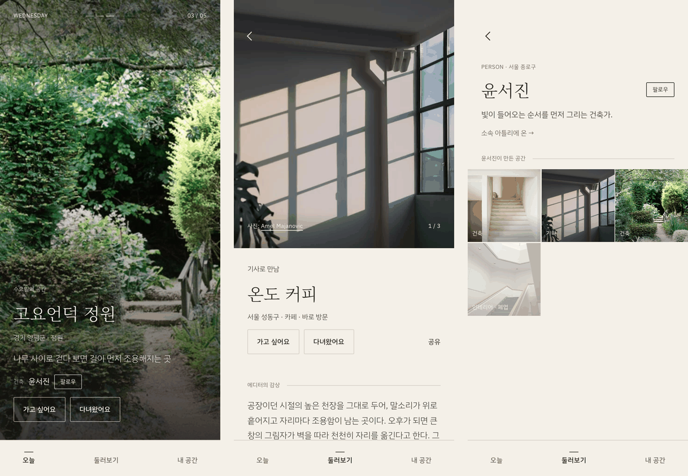
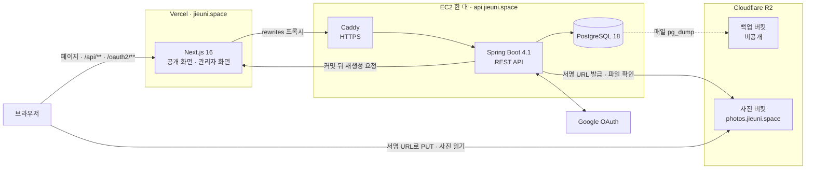
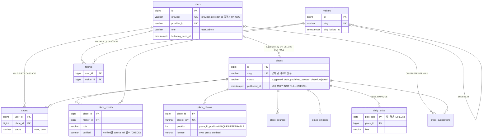
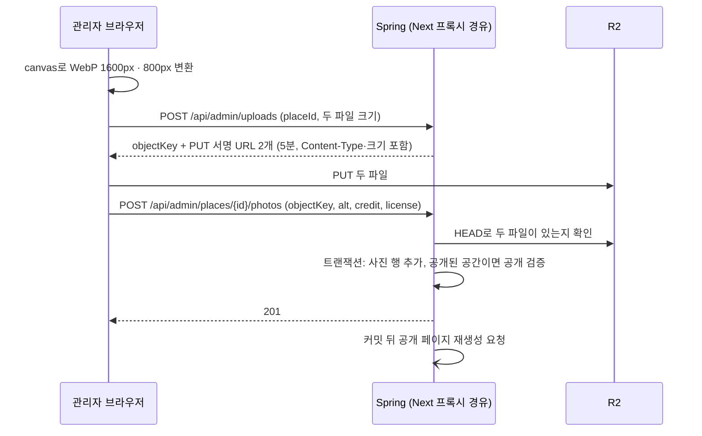
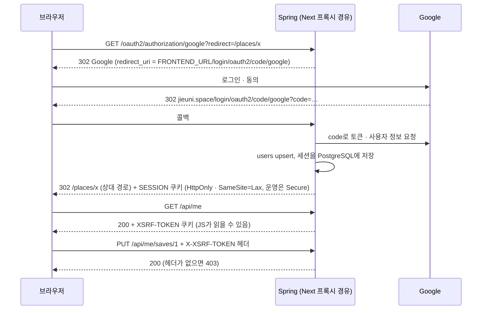

# 공간의 지은이

좋은 공간과 그 공간을 만든 사람을 소개하는 모바일 웹 서비스입니다. 줄여서 **지은이**라고 부릅니다.

운영 주소: **https://jieuni.space**



## 무엇을 하는 서비스인가

- 평일 오전 8시(KST)에 공간 한 곳을 공개합니다. 한 주에 다섯 곳이고, 끝이 있는 피드입니다.
- 공간마다 그 공간을 만든 사람(건축가, 디자이너, 조경가, 주인)을 출처와 함께 적습니다. 만든 사람을 팔로우하면 그 사람의 다른 공간을 모아 볼 수 있습니다.
- 사용자는 공간을 "가고 싶어요 / 다녀왔어요"로 저장하고, 모르는 공간을 제보합니다. 좋아요, 별점, 저장 수 같은 숫자는 보여 주지 않습니다.
- 콘텐츠는 관리자 화면에서 등록하고 공개합니다. 공개할 때 필수 항목을 서버가 검사합니다.

## 구조



브라우저는 백엔드를 직접 부르지 않습니다. Next.js가 `/api/**`, `/oauth2/**`, `/login/oauth2/**`를 백엔드로 넘겨서, 프론트와 API가 같은 출처가 됩니다. 사진 파일만 브라우저와 R2가 직접 주고받습니다.

## 데이터 모델



[마이그레이션](backend/src/main/resources/db/migration/)에서 핵심 테이블과 주요 제약만 옮겼습니다. 사용자를 지우면 저장·팔로우는 함께 지워지고, 제보는 남되 작성자만 비웁니다. 세션 테이블과 아직 쓰지 않는 `llm_calls`, 출처·임베드의 컬럼은 생략했습니다.

## 주요 흐름

### 사진 업로드



서버는 서명 URL만 만들고 파일을 받지 않습니다. 등록되지 않은 채 24시간이 지난 파일은 매일 03:00(KST) 정리 작업이 지웁니다.

### 로그인과 CSRF



로그인에 성공하면 CSRF 쿠키가 지워집니다. 그래서 돌아온 뒤 `GET /api/me`로 새 토큰을 받고, 로그인 전에 누른 저장·팔로우를 이어서 보냅니다.

## 기술 결정

| 결정 | 이유 | 대가 |
| --- | --- | --- |
| 서버 세션(Spring Session JDBC) + HttpOnly 쿠키 | 토큰을 JS에 두지 않습니다. 로그아웃·탈퇴가 바로 반영됩니다 | 요청마다 세션을 DB에서 읽고, 만료된 세션 행 정리가 필요합니다(Spring Session 기본 정리 작업이 1분마다 지웁니다) |
| Next rewrites로 같은 출처 프록시, CORS 없음 | 출처가 다르면 credentials를 허용하는 CORS를 열어야 하고, API 도메인이 심은 CSRF 쿠키를 프론트 JS가 읽으려면 쿠키 도메인을 넓혀야 합니다. 같은 출처로 두면 둘 다 필요 없습니다 | API 응답이 Next 서버를 한 번 더 거칩니다 |
| JPA + 공개 목록은 DTO 프로젝션 쿼리 | 관리자 CRUD는 짧게, 목록은 N+1 없이 씁니다. 목록 API마다 쿼리 수를 테스트로 고정했습니다 | 암묵적 동작이 많아 SQL이 다 보이지 않습니다 |
| 필수 항목은 공개할 때 검사 | 제보·작성 중인 공간은 빈칸이 정상입니다. 백엔드 `PublishRules`와 프론트 Zod 스키마가 같은 키·문구를 씁니다 | 규칙이 두 곳에 있어 함께 고쳐야 합니다 |
| 피드 공개 여부를 조회 시점에 계산 | 스케줄러가 실패해도 공개 시각이 정확합니다. 시계를 고정해 경계(07:59 / 08:00)를 테스트합니다 | 페이지 캐시 갱신은 따로 챙겨야 합니다 |
| 사진은 서명 URL로 R2에 직접 업로드, 변환은 브라우저에서 | 파일이 서버를 거치지 않고, 서버에 이미지 라이브러리가 필요 없습니다 | 등록이 빠진 파일을 지우는 정리 작업이 필요합니다 |
| Vercel + EC2 한 대(Docker Compose + Caddy) | 혼자 운영할 수 있는 크기입니다. 백엔드 이미지는 CI가 만들어 GHCR에 올립니다 | 서버가 하나라 장애 지점도 하나입니다. 백업(매일 `pg_dump` → R2, 7일 보관)과 복원 확인을 직접 합니다 |

자세한 비교와 포기한 선택지는 [docs/DECISIONS.md](docs/DECISIONS.md)에 있습니다.

## 문제 해결

- **동시 저장에서 500**: "있으면 갱신, 없으면 저장"을 엔티티로 하면, 같은 요청이 동시에 올 때 둘 다 INSERT해 중복 키 오류가 납니다. PostgreSQL `INSERT … ON CONFLICT`로 바꾸고, 8개 요청을 동시에 보내는 테스트로 행이 하나만 남는 것을 확인했습니다. 제보 하루 한도도 같은 방식으로 경합을 재현해 사용자 행 잠금으로 막았습니다.
- **둘러보기 목록이 인덱스를 쓰지 않음**: `status in (...)` 조건 때문에 기존 인덱스로는 정렬 순서를 만들 수 없었습니다. 부분 인덱스와 행 비교 커서 `(published_at, id) < (?, ?)`로 바꿨습니다. 2만 행 합성 데이터에서 첫 페이지는 5.337 → 0.043ms, 8,000번째 뒤 페이지는 3.497 → 0.045ms입니다([scripts/explain-browse.sh](scripts/explain-browse.sh)로 재현, 시간은 기계마다 다릅니다). 지금 운영 데이터는 수십 행이라 체감 차이는 없습니다.
- **프록시 뒤 OAuth 리디렉트**: Next 프록시가 Host를 백엔드 주소로 바꿔, 로그인 뒤 이동 주소가 `http://backend:8080/…`이 됐습니다. 테스트(MockMvc)로는 보이지 않았고 compose와 curl로 찾았습니다. 상대 경로 리디렉트를 켜고 `redirect_uri`는 설정값으로 고정했습니다.

상황, 원인, 해결, 확인, 한계는 [docs/TROUBLESHOOTING.md](docs/TROUBLESHOOTING.md)에 있습니다.

## 로컬 실행

Docker가 필요합니다. 첫 빌드는 Gradle·npm 의존성과 Google Fonts를 받으므로 네트워크가 필요합니다.

```bash
cp .env.example .env
# .env에서 POSTGRES_PASSWORD 한 줄만 채우면 뜹니다.
docker compose up --build
```

- http://localhost:3000 에서 피드, 둘러보기, 공간 상세, 만든 사람 프로필을 볼 수 있습니다. 백엔드가 `dev` 프로필로 떠서 가짜 시드 5곳([seed/seed.json](seed/seed.json))을 넣습니다.
- R2와 구글 값이 비어 있어 사진 업로드와 구글 로그인은 동작하지 않습니다.
- 예전에 다른 비밀번호로 만든 DB 볼륨이 있으면 백엔드가 `password authentication failed`로 멈춥니다. 같은 비밀번호를 쓰거나, 로컬 데이터를 버려도 될 때만 `docker compose down -v`로 볼륨을 지웁니다.

**로그인·관리자 화면을 보려면** 개발 서버로 프론트를 띄웁니다. 로그인 시트에 개발용 로그인 버튼이 생깁니다(구글 없이 이메일로 로그인, `dev`·`test` 프로필에만 있음).

```bash
# .env에 ADMIN_EMAILS=dev@jieuni.local 을 넣으면 그 계정이 관리자가 됩니다.
docker compose up --build -d db backend
cd frontend && npm ci
API_URL=http://localhost:8080 npm run dev
```

**테스트**

```bash
cd backend && ./gradlew test   # Testcontainers로 PostgreSQL을 띄웁니다(Docker 필요)
cd frontend && npm test        # 순수 함수만(Vitest)
```

## 문서 지도

| 문서 | 무엇을 | 언제 읽나 |
| --- | --- | --- |
| [docs/SPEC.md](docs/SPEC.md) | 지키는 규칙, 데이터, 화면별 동작, 공개 뒤 계획 | 서비스가 무엇을 하는지 알고 싶을 때 |
| [docs/API.md](docs/API.md) | 경로, 요청·응답, 상태 코드, 서비스 사이 계약 | API 설계를 볼 때 |
| [docs/DECISIONS.md](docs/DECISIONS.md) | 기술 결정, 이유, 대가 | 왜 이렇게 만들었는지 궁금할 때 |
| [docs/TROUBLESHOOTING.md](docs/TROUBLESHOOTING.md) | 문제 해결 사례 3건 | 구현 중에 부딪힌 문제를 볼 때 |
| [docs/DESIGN.md](docs/DESIGN.md) | 색, 글꼴, 간격, 컴포넌트, 화면 수치 | 화면을 고칠 때 |
| [docs/RUNBOOK.md](docs/RUNBOOK.md) | 배포, 되돌리기, 백업과 복원 | 운영 서버를 다룰 때 |
